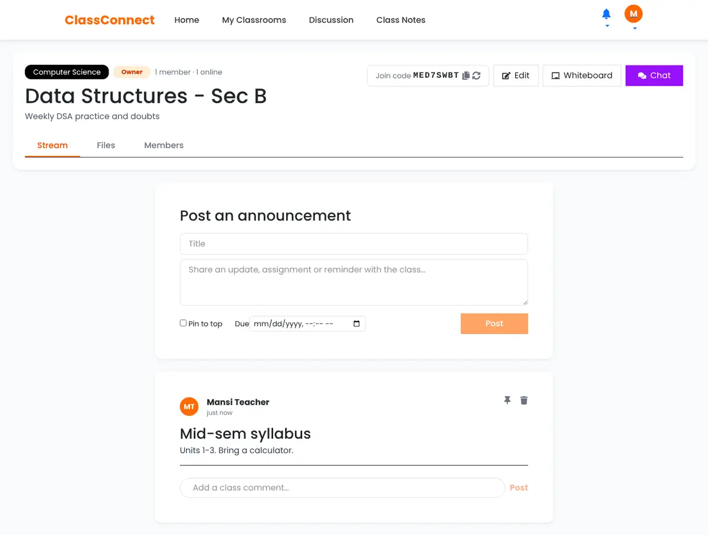
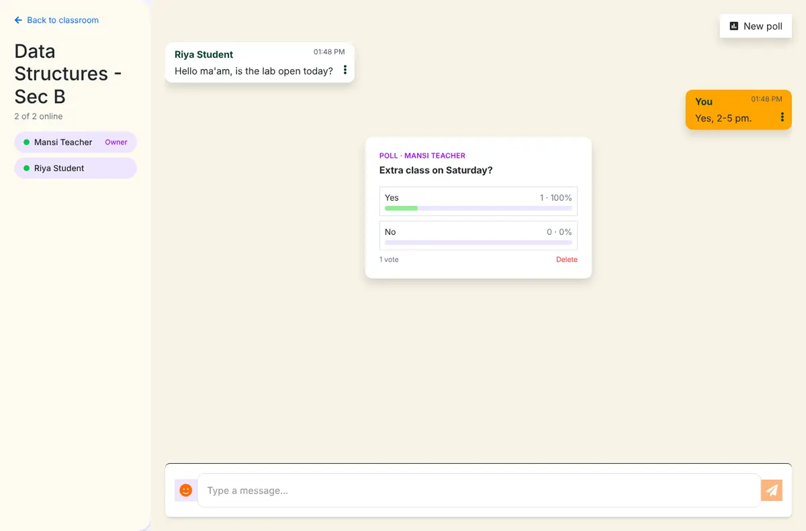
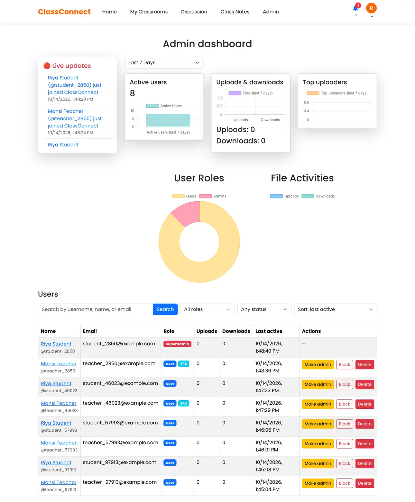
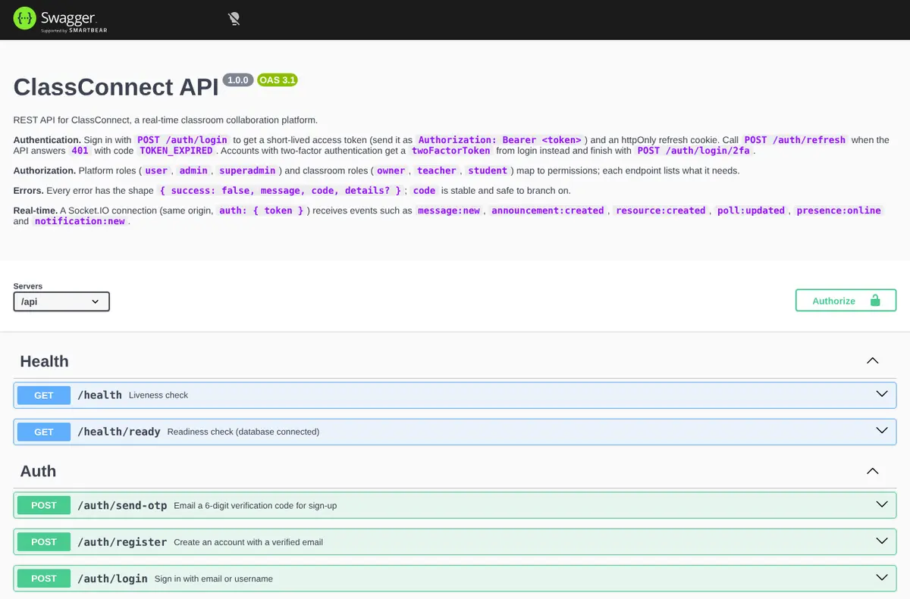
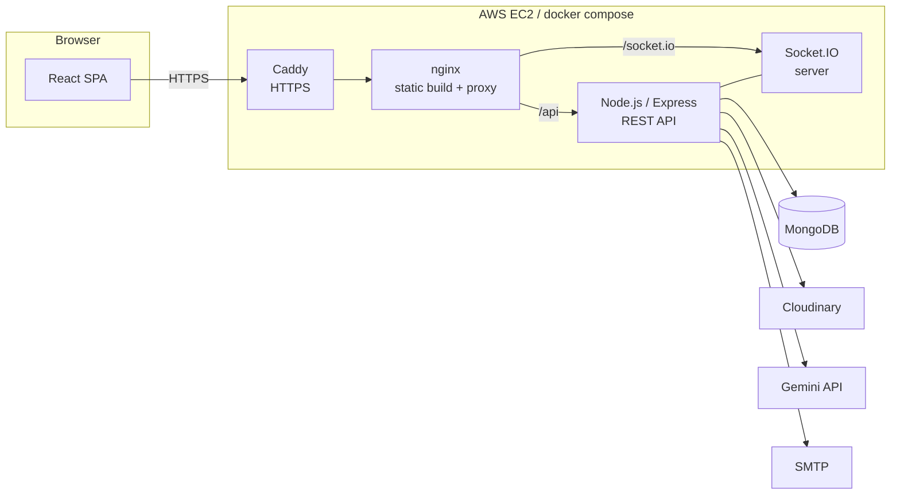
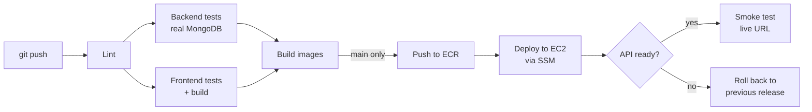

# ClassConnect

[](https://github.com/Mansimaavi/Class-Connect/actions/workflows/ci-cd.yml)

A real-time classroom collaboration platform. Teachers create classrooms, students join with a code, and everyone shares announcements, files, chat, polls and a live whiteboard, with updates pushed instantly over WebSockets.

**Stack:** React · Node.js · Express · MongoDB · JWT · Socket.IO · Docker · AWS · GitHub Actions

| Classroom stream | Real-time chat & polls |
| --- | --- |
|  |  |
| **Admin dashboard** | **API docs (OpenAPI / Swagger)** |
|  |  |

---

## Features

### Real-time collaboration (Socket.IO)
- **Classroom chat**: messages, edits, deletes, bulk delete, read receipts, typing indicators and who's-online presence.
- **Live polls**: create a poll in chat and watch votes update for everyone.
- **Announcements stream**: new posts, comments, pins and edits appear without refreshing.
- **Notifications**: a bell that updates live when someone joins your classroom, posts an announcement or uploads a file.
- **Shared whiteboard**: drawing is broadcast to everyone in the room and saved, so late joiners see the full board.
- **Admin activity feed**: sign-ups and platform stats stream to the admin dashboard.

The socket server authenticates every connection with the same JWT as the REST API and only lets users join rooms for classrooms they belong to.

### Authentication & authorization
- **JWT access tokens** (15 min, kept in memory) plus **rotating refresh tokens** in an `httpOnly` cookie. Each refresh issues a new token. If an old one is replayed, the server treats it as stolen and signs out every session.
- **Two-factor authentication (TOTP)** with any authenticator app: QR-code setup, encrypted secrets (AES-256-GCM), replay protection and one-time recovery codes.
- **Role-based access control** at two levels:
  - platform roles `user` → `admin` → `superadmin` (admins can't act on peers or anyone above them)
  - classroom roles `owner` → `teacher` → `student`
  
  Routes declare the permission they need (`requirePermission("announcement:create")`), and middleware resolves it from the user's role.
- Email OTP verification on sign-up, password reset links, session list with "sign out this device" and "sign out everywhere".
- Hardening: Helmet, CORS allow-list, rate limits on auth/OTP/upload routes, NoSQL-injection sanitising, bcrypt password hashing, account blocking.

### Classrooms & content
- Create or join classrooms with a join code; owners can rotate the code, promote students to teachers and remove members.
- Announcements with comments, pinning and due dates.
- File sharing (PDFs, slides, images) stored on Cloudinary, with per-student progress tracking.
- **AI PDF summaries** with a custom word limit (Google Gemini).
- Public **class notes** library with subject filters and ratings, plus an open **discussion forum** with answers and reactions.

### REST API
- Consistent JSON contracts: every error returns `{ success: false, message, code, details? }`, and validation errors list the exact field (`details: [{ field, message }]`).
- Request validation with **zod** schemas, pagination on all list endpoints.
- Interactive **OpenAPI 3.1 docs** at `/api/docs`.
- Structured logging (pino) with request IDs, health and readiness probes.

### Testing & DevOps
- **140 backend tests** (unit + integration with Vitest and Supertest), including Socket.IO tests with real clients. About **88% line coverage**.
- Frontend tests with Vitest + React Testing Library.
- Multi-stage **Docker** images (non-root, health-checked) and a one-command **docker compose** stack.
- **GitHub Actions** pipeline: lint → test → build Docker images → push to **Amazon ECR** → zero-SSH deploy to **EC2** through **SSM**, with automatic rollback and a live smoke test.
- Infrastructure as code with **CloudFormation**: ECR, EC2, Elastic IP, IAM roles with GitHub OIDC (no long-lived AWS keys), Parameter Store secrets and CloudWatch Logs.

---

## Architecture



The browser only ever talks to one origin. nginx serves the React build and proxies `/api` and `/socket.io` to the Node process, so cookies stay first-party and there's no CORS in production.

### CI/CD pipeline



---

## Project structure

```
Class-Connect/
├── Backend/
│   ├── app.js, index.js        # Express app + HTTP/Socket.IO server
│   ├── config/                 # env validation (zod), database, roles & permissions
│   ├── Controllers/            # route handlers grouped by feature
│   ├── middleware/             # auth, RBAC, validation, rate limits, errors, uploads
│   ├── models/                 # Mongoose schemas
│   ├── routes/                 # REST routes (/api/...)
│   ├── services/               # auth sessions, 2FA, notifications, storage, summaries
│   ├── socket/                 # Socket.IO auth, rooms, presence, event handlers
│   ├── validators/             # zod request schemas
│   ├── docs/openapi.js         # OpenAPI spec served at /api/docs
│   ├── scripts/                # create super admin, migrate old data
│   ├── tests/                  # unit + integration tests
│   └── Dockerfile
├── Frontend/
│   ├── src/
│   │   ├── Pages/              # routed pages
│   │   ├── Components/         # classroom, chat, admin, auth, discussion UI
│   │   ├── lib/                # axios client (token refresh), socket client
│   │   └── hooks/
│   ├── nginx/                  # production nginx config
│   └── Dockerfile
├── deploy/                     # production compose file, Caddyfile, deploy script
├── infra/aws/                  # CloudFormation template + secrets helper
├── .github/workflows/ci-cd.yml
└── docker-compose.yml          # full stack locally
```

---

## Getting started

### Option 1: Docker (everything in one command)

```bash
git clone https://github.com/Mansimaavi/Class-Connect.git
cd Class-Connect
docker compose up --build
```

Open http://localhost:8080. API docs are at http://localhost:8080/api/docs.

Emails aren't sent in this mode. Sign-up codes are printed to the API logs instead:

```bash
docker compose logs -f api | grep "verification code"
```

### Option 2: Run the apps directly

Requirements: Node.js 20+ and a MongoDB instance (local, Docker, or a free Atlas cluster).

```bash
# API
cd Backend
cp .env.example .env        # set MONGO_URI and the three secrets (openssl rand -hex 32)
npm install
npm run dev                 # http://localhost:5000

# Web app (new terminal)
cd Frontend
npm install
npm run dev                 # http://localhost:5173
```

Vite proxies `/api` and `/socket.io` to the API, so no extra frontend config is needed. If `MAIL_HOST` is empty, verification codes are logged to the API console.

Cloudinary keys are needed for file uploads and a Gemini key for PDF summaries. Everything else works without them.

### Make yourself an admin

```bash
cd Backend
npm run seed:admin -- --email you@example.com
```

This promotes an existing account to `superadmin`. To create a fresh account instead, add `--name`, `--username` and set `SUPERADMIN_PASSWORD`.

---

## Tests

```bash
cd Backend
npm test                  # unit + integration
npm run test:coverage     # with coverage report

cd ../Frontend
npm test
```

Integration tests use the MongoDB at `MONGO_URI_TEST` if it's set, otherwise they start an in-memory MongoDB automatically. They cover sign-up/login, refresh-token rotation and reuse detection, 2FA, RBAC rules, classrooms, announcements, chat, polls, file sharing and Socket.IO events.

---

## API overview

Full interactive docs: **`/api/docs`**

| Area | Endpoints |
| --- | --- |
| Auth | `POST /api/auth/send-otp` · `register` · `login` · `login/2fa` · `refresh` · `logout` · `logout-all` · `GET /api/auth/me` · `sessions` |
| 2FA | `GET /api/auth/2fa` · `POST setup` · `enable` · `disable` · `recovery-codes` |
| Users | `GET/PATCH /api/users/me` · `PATCH /me/email` · `/me/password` · `GET /api/users/:id` |
| Classrooms | `GET/POST /api/classrooms` · `POST /join` · `GET/PATCH/DELETE /:id` · `POST /:id/join-code` · `/:id/leave` |
| Members | `GET /:id/members` · `PATCH/DELETE /:id/members/:userId` |
| Announcements | `GET/POST /:id/announcements` · `PATCH/DELETE /:id/announcements/:aid` · comments |
| Resources | `GET/POST /:id/resources` · `download` · `progress` · `summary` |
| Chat | `GET/POST /:id/messages` · edit · delete · bulk delete · seen · polls & votes |
| Notes & forum | `/api/class-notes` · `/api/questions` · `/api/answers` |
| Notifications | `GET /api/notifications` · mark read |
| Admin | `/api/admin/users` · `role` · `status` · `stats` · `activity` · `locations` |
| Health | `GET /api/health` · `/api/health/ready` |

### Socket.IO events

| Client → server | Server → client |
| --- | --- |
| `classroom:join`, `classroom:leave` | `message:new`, `message:updated`, `message:deleted`, `messages:seen` |
| `typing:start`, `typing:stop` | `typing`, `presence:online`, `presence:offline` |
| `whiteboard:join`, `whiteboard:leave` | `poll:created`, `poll:updated`, `poll:deleted` |
| `whiteboard:element`, `whiteboard:clear` | `announcement:created` / `updated` / `deleted`, `announcement:comment-added` / `comment-deleted` |
| | `resource:created`, `resource:deleted`, `progress:updated` |
| | `member:joined`, `member:left`, `member:updated`, `member:removed`, `classroom:updated`, `classroom:deleted` |
| | `notification:new`, `whiteboard:element`, `whiteboard:cleared` |
| | `stats:updated`, `admin:activity` (admins only) |

---

## Deployment

The app runs on AWS: Docker images in ECR, an EC2 instance running the compose stack behind Caddy (automatic HTTPS), MongoDB Atlas for the database. Every push to `main` that passes the tests is deployed automatically.

Step-by-step setup: **[docs/DEPLOYMENT.md](docs/DEPLOYMENT.md)**

---

## Flow chart


